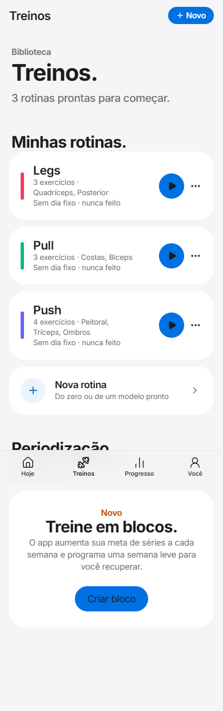
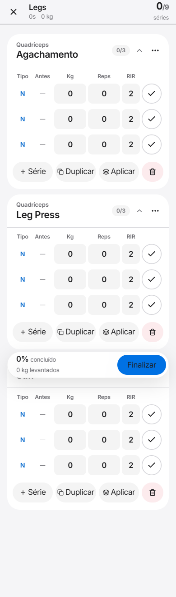
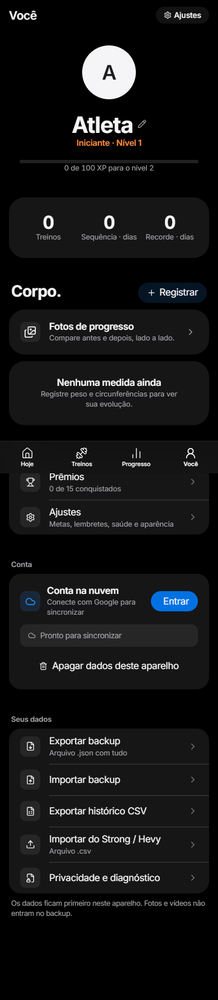
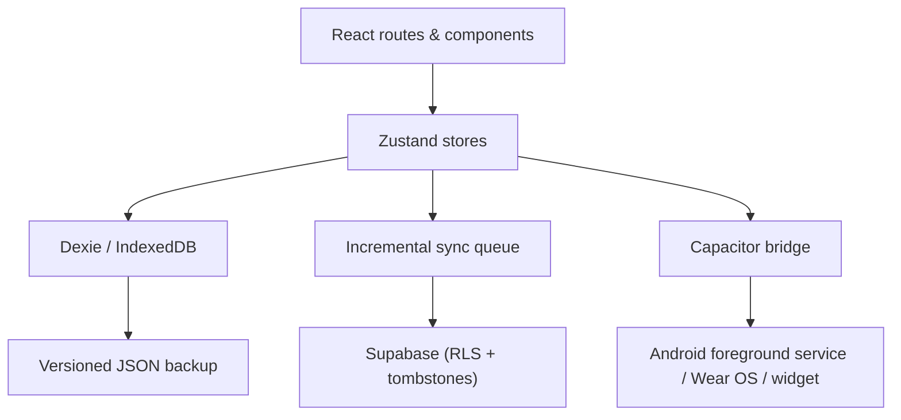

# WorkoutPro

> A local-first strength-training tracker for Android and the web, with optional cloud sync and a Wear OS companion app.

WorkoutPro lets you plan routines, log sets, run rest timers and track progress over time. Your data lives on the device (IndexedDB), works without an account, and can optionally be synced across devices with Supabase. The same static Next.js bundle is packaged for Android with Capacitor.

> **Status:** active development. The app UI and the exercise library are in Brazilian Portuguese (pt-BR); the code and this README are in English. Project documents under [`docs/`](docs/) are currently in Portuguese. It is not published on the Play Store yet (see [`docs/ANDROID-RELEASE.md`](docs/ANDROID-RELEASE.md) for the release checklist).

## Screenshots

Captured from the Playwright visual-regression suite (`tests/e2e/visual.spec.ts`).

| Routines | Workout execution | Profile (dark) |
|---|---|---|
|  |  |  |

## Features

**Training**
- Routines with target sets, rep range, per-exercise rest, supersets, weekly schedule and a per-exercise progression rule.
- Set-by-set execution that shows the previous session next to the current set; warm-up, working, drop, failure and AMRAP set types; RIR/RPE; duplicate/propagate values.
- Transparent double progression: the load only goes up when every working set hits the top of the rep range at the minimum RIR. It is a suggestion and never changes weights on its own.
- Built-in exercise library (~200 exercises, pt-BR) with instructions, common mistakes, secondary muscles, equipment and level. Illustrations come from the public-domain [free-exercise-db](https://github.com/yuhonas/free-exercise-db), loaded on demand and pinned to a commit.
- Mesocycles/periodization blocks with deload weeks, a routine generator that draws from the library, automatic warm-ups, discomfort notes and a plate calculator.

**Progress & health**
- Period comparisons, charts, consistency heatmap, muscle map, weekly volume per muscle against targets, estimated 1RM, PR detection, body measurements and weight trend.
- XP, levels, streaks and achievements.
- Health Connect integration on Android (heart rate, cardio with live HR zones, readiness/recovery hints, strength sessions written back).

**Android & Wear OS**
- Foreground-service rest timer with notification actions (+15 s / skip), reminders, home-screen widget, app shortcuts and `workoutpro://` deep links.
- Wear OS companion app (Compose for Wear OS, Health Services) that logs sets from the watch and shows rest countdown and heart rate. Protocol and architecture: [`docs/WEAR-OS.md`](docs/WEAR-OS.md).

**Data ownership**
- Full JSON backup (versioned envelope, validated, previewed and confirmed before restore) and Strong/Hevy-compatible CSV import/export.
- Sanitized, local-only diagnostics log that the user can export or delete.

## Tech stack

| Area | Technology |
|---|---|
| Web | Next.js 16 (App Router, static export), React 19, TypeScript, Tailwind CSS 4 |
| State & storage | Zustand 5, Dexie 4 / IndexedDB, `date-fns` |
| Cloud (optional) | Supabase (Auth with Google, Postgres, Row Level Security) |
| Mobile | Capacitor 8 (Android SDK 36, min SDK 26), Kotlin Wear OS module, Health Connect |
| Testing | Vitest, Testing Library, fake-indexeddb, Playwright (e2e + visual), Maestro (device flows) |
| Tooling | ESLint 9, Android Lint, R8 release bundle |

## Architecture highlights



- **Local-first.** IndexedDB is the source of truth on the device; the cloud is optional and the app is fully usable with no Supabase configuration.
- **Safe, incremental sync.** One immutable queue item per entity/ID; an item is removed only after its own upload is confirmed; deletions are tombstones (`deleted_at`); offline never discards changes.
- **Conflict handling.** `updatedAt` comparison detects a newer cloud record; conflicts are stored and the user chooses local or cloud per conflict. Automatic pulls merge per entity and never overwrite pending records.
- **Atomic, idempotent writes.** Finishing a workout saves session + profile + queue items in one Dexie transaction; repeating it with the same `sessionId` is a no-op. Profile aggregates can be rebuilt from sessions (`reconcileProfile`).
- **Timers survive reloads.** Durations derive from persisted timestamps, not in-memory counters.
- **Security.** Supabase Row Level Security policies live in [`supabase/schema.sql`](supabase/schema.sql) and are covered by a schema test (`tests/securitySchema.test.ts`).

More detail (data model, invariants, sync): [`docs/BASE-DE-CONHECIMENTO.md`](docs/BASE-DE-CONHECIMENTO.md) and [`docs/REVISAO-DE-CODIGO.md`](docs/REVISAO-DE-CODIGO.md) (both in Portuguese).

## Getting started

```bash
npm install
npm run dev
```

Supabase is optional. To enable Google sign-in, cloud backup and multi-device sync, create `.env.local`:

```dotenv
NEXT_PUBLIC_SUPABASE_URL=...
NEXT_PUBLIC_SUPABASE_ANON_KEY=...
```

Then apply [`supabase/schema.sql`](supabase/schema.sql) to your Supabase project. Without these variables the whole local flow keeps working and the profile screen explains that cloud features are disabled. To validate RLS with two real accounts, follow [`docs/SUPABASE-STAGING.md`](docs/SUPABASE-STAGING.md).

### Android

```bash
npm run android:sync     # build the static export and copy it into the Capacitor project
npm run android:apk      # debug APK
npm run android:check    # unit tests + Android Lint
npm run android:bundle   # release AAB (R8 + resource shrinking)
npm run android:wear     # Wear OS companion debug APK
```

Some `android*` scripts call PowerShell and assume a Windows setup (Android Studio JBR); `android:sync`, `android:apk` and `android:wear` work on Linux/macOS with a JDK and the Android SDK.

## Tests

```bash
npm run lint
npx tsc --noEmit
npm test                # Vitest: 27 unit/integration test files
npm run test:e2e        # Playwright end-to-end
npm run test:visual     # Playwright visual regression
npm run test:device     # Maestro flows on an emulator/device (wipes app data, see docs)
npm run audit:visual    # structural visual audit (light/dark, mobile/desktop)
```

> Device flows clear all WorkoutPro data on the target device. Use an emulator or a spare phone.

## Project layout

```
app/          Next.js routes (dashboard, workouts, stats, cardio, health, sleep, profile, ...)
components/   UI, timer, charts, auth, health, navigation
stores/       Zustand stores (workouts, profile, active session, timers)
lib/          Dexie, backup, sync queue/cursor, training logic, health, Wear/widget bridges
supabase/     Postgres schema, indexes, triggers, RLS policies
android/      Capacitor Android app + Wear OS module
tests/ e2e/   Vitest, Playwright and Maestro suites
docs/         Architecture, review notes, release and Wear OS docs (pt-BR)
```

## License

No license has been chosen yet; all rights reserved by default.
