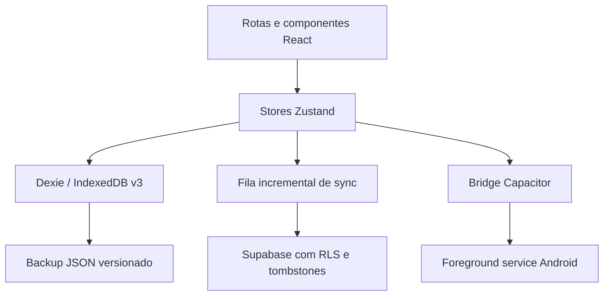

# Base de conhecimento do WorkoutPro

## Experiência de produto atual

- Navegação principal com quatro destinos: Início, Treinos, Progresso e Perfil. Conquistas foram incorporadas a Progresso.
- Superfícies de conteúdo são opacas; blur e transparência ficam reservados à navegação e aos controles flutuantes.
- Rotinas guardam séries alvo, faixa de repetições, descanso, supersérie, agenda semanal e regra de progressão por exercício.
- A execução mostra o treino anterior ao lado da série atual e suporta aquecimento, trabalho, drop set, falha e AMRAP, além de RIR, duplicação e propagação de valores.
- Exercícios guardam equipamento, ajuste da máquina, alternativas e notas técnicas.
- O Perfil oferece backup JSON completo, importação/exportação CSV compatível com Strong/Hevy e perfil de equipamentos.

### Regra de progressão

A progressão dupla é deliberadamente previsível: a carga só sobe quando todas as séries de trabalho alcançam o limite superior da faixa mantendo o RIR mínimo configurado. Séries de aquecimento não entram nessa decisão. A sugestão é informativa e nunca altera a carga sem ação do usuário.

### Compatibilidade de dados

Os novos campos são opcionais para que registros legados continuem válidos. O schema Supabase usa `jsonb` para configurações por exercício e arrays para agenda, equipamentos e alternativas. Ao atualizar uma instalação com nuvem, reaplique `supabase/schema.sql` antes de sincronizar os novos campos.

> Atualizada em 19/08/2026 a partir do código e das alterações locais do projeto.

## Visão geral

WorkoutPro é um aplicativo mobile-first de musculação. Ele permite criar fichas e exercícios, executar treinos série a série, controlar duração e descanso, acompanhar volume/frequência/1RM, registrar medidas, ganhar XP e conquistas e mover os dados por backup JSON ou sincronização Supabase.

O produto é local-first: o Dexie/IndexedDB é a fonte primária no aparelho. Conta e nuvem são opcionais. A interface web é exportada estaticamente e o Android carrega o mesmo conteúdo por Capacitor.

## Arquitetura



| Camada | Local | Responsabilidade |
|---|---|---|
| Telas | `app/**` | Fluxos, formulários, gráficos e metadados por rota. |
| Componentes | `components/**` | Shell, navegação, autenticação, timer e UI. |
| Estado | `stores/**` | Treinos, perfil, sessão ativa e relógios. |
| Domínio/persistência | `lib/**` | Dexie, backup, sync, cálculos, seed e notificações. |
| Contratos | `types/index.ts` | Entidades locais, sessão ativa, fila e conflitos. |
| Nuvem | `supabase/schema.sql` | Tabelas, índices, triggers de atualização e RLS. |
| Android | `android/**` | Capacitor, deep link OAuth, plugin e serviço de timer. |

### Stack validada

| Área | Tecnologia |
|---|---|
| Web | Next.js 16.3.1, React 19.2.4, App Router e `output: 'export'` |
| UI | Tailwind CSS 4, componentes nativos do projeto e Lucide |
| Estado/local | Zustand 5, Dexie 4 e IndexedDB |
| Nuvem opcional | Supabase JS 2, Google Auth e Postgres/RLS |
| Mobile | Capacitor 8, Android SDK 36, Gradle 8.14.5 e Java |
| Testes | Vitest 4, Testing Library, jsdom, fake-indexeddb e Playwright 1.62 |

## Inicialização

1. `app/layout.tsx` monta `AppShell` e os metadados globais.
2. O shell sincroniza tema, efeitos visuais, service worker e contexto nativo.
3. `AuthGate` detecta se o Supabase está configurado. Sem configuração, inicia diretamente o modo local.
4. Com uma conta conectada, o sync automático processa a fila, baixa mudanças e reconcilia agregados.
5. Sem dados locais, o seed cria o conteúdo de demonstração.
6. Stores carregam Dexie e o perfil verifica conquistas.
7. Eventos de mutação, conectividade e retorno ao primeiro plano agendam novo sync.

## Modelo de dados

O banco `WorkoutProDB` está na versão 3.

| Store Dexie | Entidade | Observações |
|---|---|---|
| `workouts` | `Workout` | Nome, cor, ícone e ordem de `exerciseIds`. |
| `exercises` | `Exercise` | Nome, grupo e notas. |
| `sessions` | `WorkoutSession` | Séries concluídas, duração, volume, XP e notas. |
| `measurements` | `BodyMeasurement` | Peso, BF, massa magra e circunferências. |
| `profile` | `UserProfile` | XP, nível, volume, treinos e sequências. |
| `achievements` | `AchievementRecord` | Conquistas desbloqueadas. |
| `syncQueue` | `SyncQueueItem` | Uma mutação atual por entidade/ID, tentativas e último erro. |
| `syncConflicts` | `SyncConflict` | Versões local/remota que exigem decisão do usuário. |

Todas as entidades sincronizadas possuem `updatedAt`. A migração v3 preenche esse campo em registros antigos. O perfil local mantém ID fixo `profile`; na nuvem, o registro é associado ao UUID autenticado.

### Invariantes

- Um exercício não é duplicado na mesma ficha.
- Excluir exercício também o remove de todas as fichas, dentro da mesma transação; sessões históricas permanecem.
- Somente séries marcadas como concluídas entram na sessão final.
- Volume é a soma de `peso × repetições`.
- Uma sessão ativa tem `sessionId` estável, evitando duplicação ao finalizar duas vezes.
- Sessão, perfil e seus itens de fila são gravados atomicamente.
- Agregados do perfil podem ser reconstruídos das sessões por `reconcileProfile`.

## Sessão, XP e timers

`useSessionStore` persiste `ActiveSession` no `localStorage` sob `workout-session`. Ao iniciar um treino, reaproveita séries da sessão anterior e cria um ID estável. Ao finalizar:

1. coleta somente séries concluídas;
2. calcula volume e novos PRs por 1RM estimado;
3. aplica XP base, volume, PR e bônus de sequência;
4. grava sessão + perfil + fila em uma transação Dexie;
5. limpa a sessão ativa apenas depois do commit.

O fechamento é idempotente: repetir a operação com o mesmo `sessionId` retorna a sessão existente sem somar o perfil novamente.

O timer usa timestamps de parede. Depois de reload/background, a duração deriva de `ActiveSession.startedAt`; o descanso deriva de `restEndAt`. Substituir, descartar, finalizar ou importar um backup encerra timers e notificações associados.

## Backup

O formato atual possui envelope:

```json
{
  "app": "WorkoutPro",
  "schemaVersion": 1,
  "exportedAt": "2026-08-19T12:00:00.000Z",
  "data": {}
}
```

`parseBackup` valida o documento inteiro antes de escrever: arrays obrigatórios, tipos, datas, IDs duplicados, grupo muscular, perfil único e referências das fichas. Backups legados completos continuam aceitos. Datas ISO voltam a ser `Date`.

A interface mostra um preview com contagens e exige confirmação. A substituição do banco e criação da fila individual ocorrem em uma transação; falha implica rollback. Depois do commit, stores são recarregados e qualquer sessão ativa antiga é descartada.

## Sincronização Supabase

O sync é opcional e incremental:

- `queueSync` substitui apenas a mutação anterior do mesmo registro por um novo item imutável.
- O upload processa cada item, confirma que ele ainda é o item atual e remove somente seu ID após sucesso.
- Exclusões usam `deleted_at` (tombstone), inclusive conquistas.
- `updated_at` permite detectar nuvem mais nova que uma mutação local.
- Conflitos são preservados em `syncConflicts` e a tela oferece manter a versão local ou a da nuvem.
- Cada conflito pode ser resolvido separadamente; ações em lote continuam disponíveis.
- O último sync bem-sucedido fica persistido e visível para orientar decisões entre aparelhos.
- Pull automático protege registros pendentes/conflitantes e faz merge por entidade.
- Substituição destrutiva só acontece no restore explícito confirmado pelo usuário.
- Falhas mantêm a fila, incrementam tentativas e exibem status; offline nunca apaga mudanças.
- Depois de merge/restore, os agregados do perfil são reconciliados a partir das sessões.

Sair da conta não apaga dados locais. “Apagar dados deste aparelho” é uma ação separada, destrutiva e confirmada.

O SQL em `supabase/schema.sql` deve ser aplicado ao backend para garantir colunas, tombstones, índices, triggers e políticas RLS compatíveis.

## Estatísticas e calendário

Períodos usam limites compartilhados em `lib/statsPeriods.ts`:

- semana: segunda a domingo;
- mês: primeiro ao último dia, com barras semanais recortadas no mês;
- ano: primeiro ao último dia;
- frequência: oito semanas completas em ordem cronológica.

O dashboard usa o mesmo início de semana. Datas civis de streak são comparadas por calendário, não por uma diferença fixa de 24 horas, evitando erro em mudanças de fuso/horário de verão.

## PWA, acessibilidade e tema

- O manifesto vem de `app/manifest.ts`; o arquivo antigo duplicado foi removido.
- O service worker é ativado em produção web e desativado em desenvolvimento/nativo.
- Zoom do navegador é permitido.
- Existe link “Pular para o conteúdo”.
- Rotas principais têm títulos próprios para anúncios de navegação.
- Os tokens CSS e os componentes nativos compartilham a mesma preferência light/dark.
- Controles numéricos por ícone possuem rótulos acessíveis.
- Inputs, selects e textareas associam seus labels por `id`; status críticos usam regiões acessíveis.
- Erros de runtime têm fallback com tentativa novamente.

## Diagnósticos e privacidade

`lib/observability.ts` mantém no máximo 25 diagnósticos somente no aparelho. Mensagens são sanitizadas para remover e-mails, URLs, tokens e segredos; stacks e conteúdo de treinos não são armazenados. Em `/privacy`, o usuário pode exportar ou apagar esses registros. Não existe envio automático a terceiros.

## Android

`TimerPlugin` rejeita chamadas que falham; o JavaScript converte erros nativos em mensagens observáveis. `TimerForegroundService`:

- usa `specialUse`, pois não acessa sensores de saúde;
- declara `FOREGROUND_SERVICE_SPECIAL_USE` e subtipo no Manifest;
- usa a sobrecarga tipada de `startForeground` em Android moderno;
- mantém duração e descanso na notificação;
- registra exceções no Logcat com tag `WorkoutProTimer`.

O Capacitor reconhece quatro plugins: App, Browser, Local Notifications e Splash Screen. Backup/transferência de dados e tráfego HTTP aberto estão desativados. O ícone adaptativo possui camada monocromática. Release usa R8 e redução de recursos. O lint Android está em 0 erros; os avisos restantes são de recursos gráficos gerados/duplicados e XMLs do template.

## Rotas

| Rota | Função |
|---|---|
| `/dashboard` | Resumo, semana, sugestão e nível. |
| `/workouts` | Lista, inicia e exclui fichas. |
| `/workouts/new` | Criação manual ou por template. |
| `/workouts/detail?id=...` | Ordem, exercícios e histórico da ficha. |
| `/workouts/execute` | Sessão ativa e resumo. |
| `/exercises/detail?id=...` | PRs e histórico do exercício. |
| `/stats` | Métricas, gráficos e calendário. |
| `/achievements` | Conquistas. |
| `/profile` | Identidade, medidas, tema, conta e backup. |
| `/privacy` | Política local, exportação e limpeza de diagnósticos. |

As rotas de detalhe usam query string porque os IDs são criados em runtime no IndexedDB e o app precisa manter `output: 'export'` para uso offline no Capacitor. O stub `/workouts/[id]` foi removido e não gera mais `/workouts/_/`.

## Operação e verificação

```bash
npm run lint
npx tsc --noEmit
npm test
npm run build
npm audit
npm run test:e2e
npm run test:visual
npm run android:sync
npm run android:check
npm run android:bundle
```

Estado validado em 19/08/2026:

| Verificação | Resultado |
|---|---|
| ESLint | Passou. |
| TypeScript strict | Passou. |
| Vitest | 9 arquivos, 25 testes aprovados. |
| Next produção | Passou; 15 páginas estáticas geradas. |
| npm audit | 0 vulnerabilidades. |
| Playwright E2E | 4 fluxos locais aprovados no build de produção. |
| Regressão visual | 4 screenshots aprovadas. |
| Auditoria estrutural Playwright | 20 capturas sem overflow, 404 ou erros de console. |
| Capacitor sync | Passou; bundle copiado. |
| Gradle testes + lint | `BUILD SUCCESSFUL`; 0 erros e 30 avisos gráficos/legados. |
| Android release | AAB gerado com R8 e redução de recursos. |

## Hotspots e riscos residuais

1. Sync real exige o schema atualizado; execute `npm run test:supabase:staging` com as duas contas descritas em `docs/SUPABASE-STAGING.md`.
2. Testes locais não substituem validação do timer, notificações, deep link e login em aparelho Android físico.
3. Os cinco assets-fonte atuais de ícone/splash são cópias da mesma imagem; artes independentes são necessárias para eliminar os 30 avisos sem degradar o visual.

Ao mudar schema, sincronização, entidades, comandos ou rotas, atualize este documento no mesmo conjunto de alterações.
